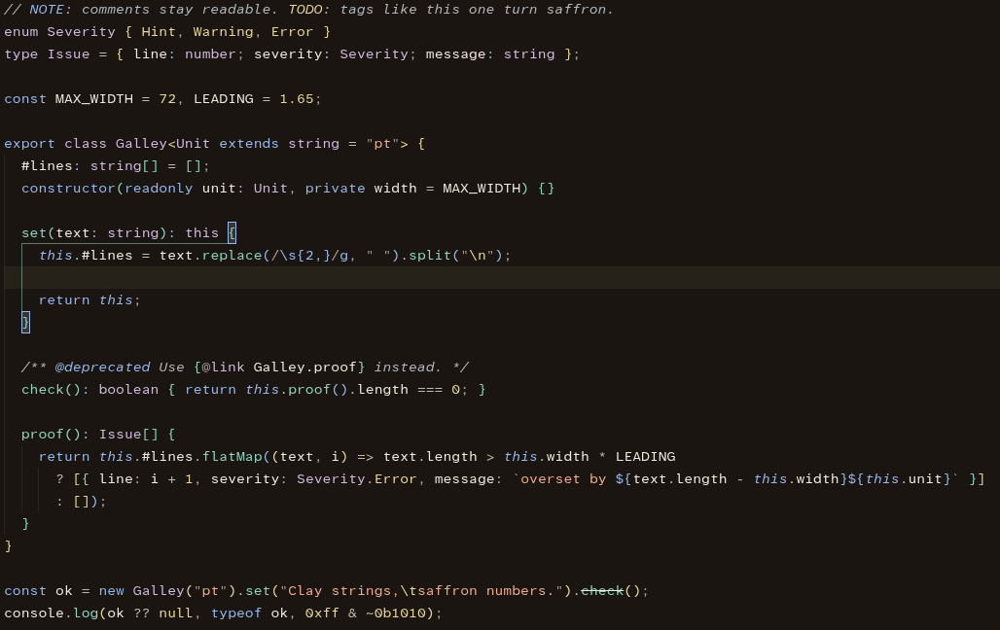
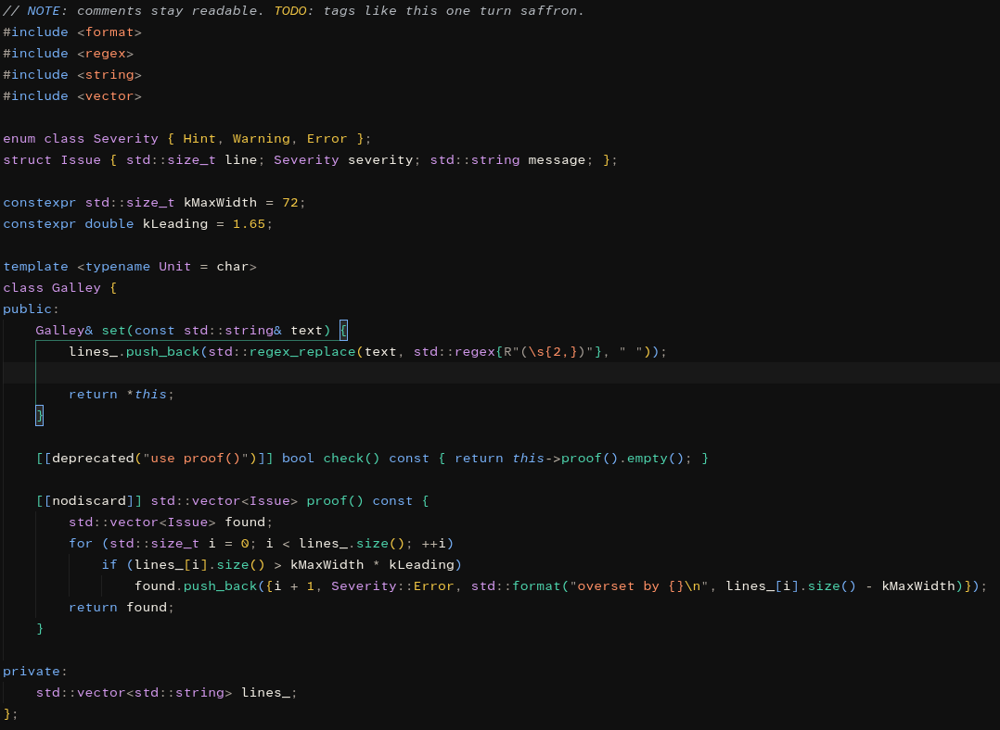
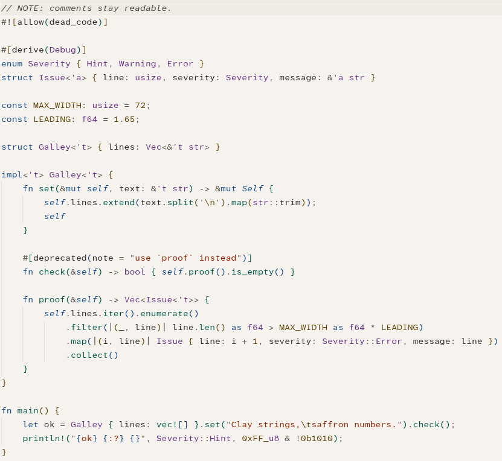
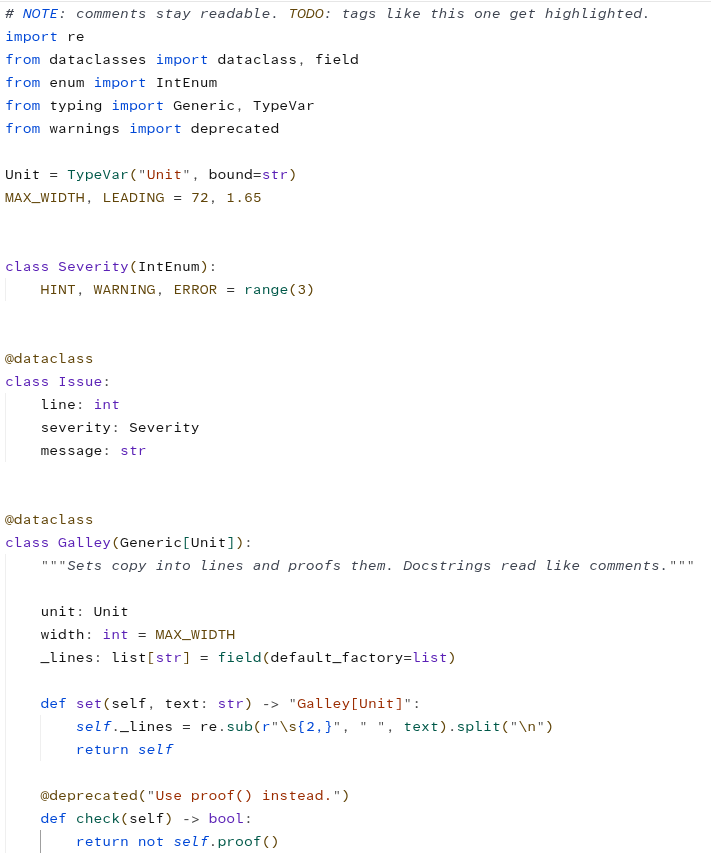

# Galley

A clear theme focused on legibility, reducing eye-strain and adding additional syntax highlighting.

## Galley



*A dark mode with soft colours to reduce eye-strain.*

## Galley Vivid



*A dark mode with more vibrant colours.*

## Galley Soft



*A light mode that's easy on the eyes.*

## Galley Projector



*A light mode with a pure white background for use with a projector.*

### Custom Font

The theme cannot change your font. This theme was intended to use Atkinson Hyperlegible Mono. First download and install it from: [Google Fonts](https://fonts.google.com/specimen/Atkinson+Hyperlegible+Mono) or the [Braille Institute](https://www.brailleinstitute.org/freefont/).

Then, add the following to your settings:
```json
{
  "editor.fontFamily": "'Atkinson Hyperlegible Mono', monospace",
  "editor.fontLigatures": false,
  "editor.fontSize": 14,
  "editor.lineHeight": 1.65,
  "editor.fontWeight": "400",
  "editor.semanticHighlighting.enabled": true,
  "editor.guides.bracketPairs": "active"
}
```
If the strokes look too thin, increase the font weight (i.e.,`"editor.fontWeight": "500"`).

**Note, only `editor.fontFamily` is required - the rest are the settings used in screenshots.**

## Installation

Either install from the Visual Studio Code Marketplace, or install manually:

1. Clone this repo.
1. Command Palette → **Developer: Install Extension from Location…**
2. Choose the directory where you cloned this repo.
3. Command Palette → **Preferences: Color Theme** → **Galley**, **Galley Vivid**, **Galley Soft**, or **Galley Projector**.
